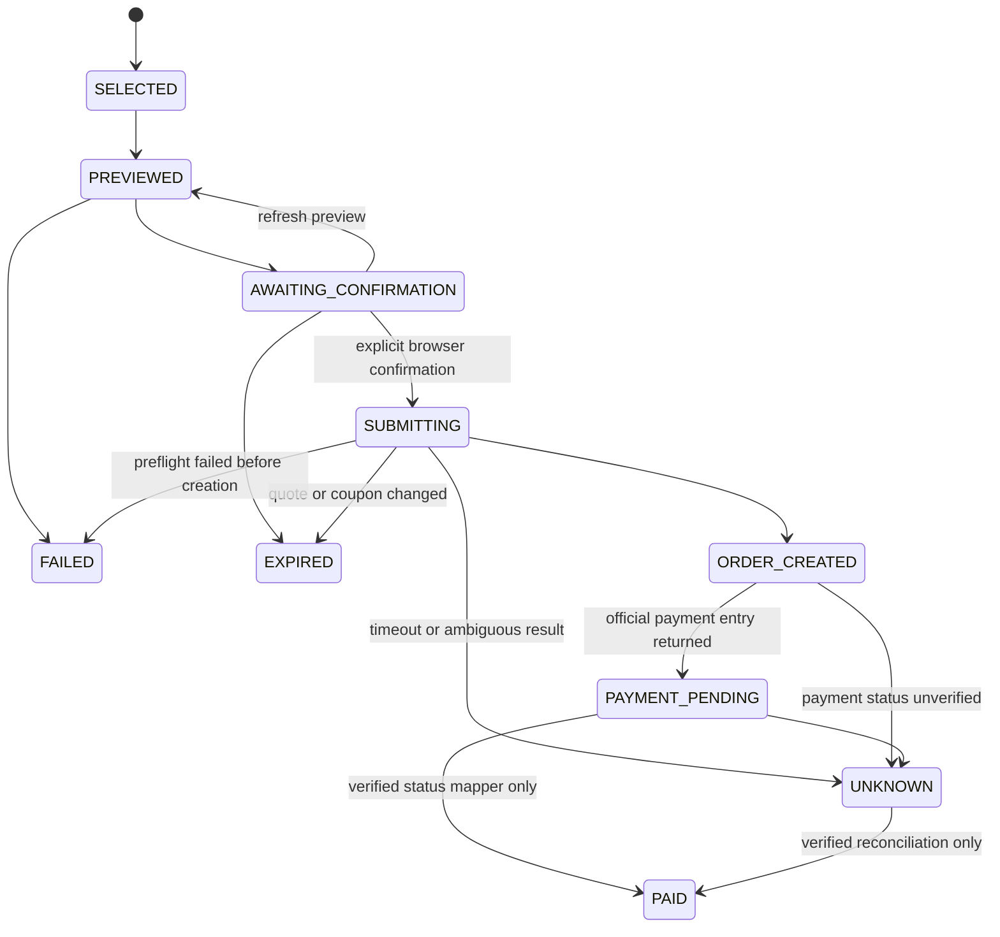

# AgentMall Dining 模型与交易边界

一个用户、一个门店、一个商品、一次交易。自然语言使用规则解析，LLM 不参与交易授权。

## OCP 与商家职责

- 六个 OCP 端点保持上游结构与官方 Schema。Query 返回商品投影，不创建订单。
- 标准 `input_fields` 声明 `filters.provider_id`、`filters.max_amount`，服务端使用官方 `validateCatalogQueryRequest`。
- 普通演示流 Resolve(checkout) 返回 Mock API 动作；已授权浏览器的瑞幸流返回 `workflow` ActionBinding，指向本地真实预览端点。
- 真实流通过会话中的已确认门店确定查询范围，用 `x-agentmall-flow: real` 和 CSRF 传递上下文；不在严格 OCP 请求中增加交易字段。
- ActionBinding 不能直接授权创建订单。真实提交是 OCP 之外的 RealCheckoutAdapter 操作，必须取得预览后的单次确认凭据。

## 状态机

PAID 转移已用 Mock MCP 的验证状态映射测试。真实 `queryOrderDetailInfo` 的字段与状态码尚未取得用户订单样本，生产适配器不会猜测；查询后展示脱敏商家返回并保持 UNKNOWN。创建订单不是付款成功。

## 不可变预览

快照包含商家返回的门店 ID/名称/地址/坐标、商品 ID、默认 SKU、数量、规格说明、订单总金额/减免/最终应付金额以及原样优惠券列表。金额使用整数分；原字段依据实际预览和瑞幸官方文档：`totalInitialPrice`、`privilegeMoney`、`discountPrice`。

- 商品详情必须给出完整可选默认规格，否则停止。
- 预览返回门店/商品/SKU/数量不一致、金额缺失或不一致时停止。
- 确认有效期 60 秒。凭据只返回当前会话，服务端存储摘要。
- 用户确认包含快照摘要、门店、商品、SKU、数量与最终应付金额，必须逐项一致。
- 创建前再调用预览；报价、优惠券或任何快照字段改变，进入 EXPIRED，不创建订单。
- 商家 createOrder 不接受我们设置的原子价格上限或幂等键，因此最后一次预览与创建之间仍存在商家变化窗口；不能承诺价格锁定。创建返回 discountPrice 时展示该金额与预览差异，付款前由用户核对，不自动支付或取消。

## 幂等与恢复

运行时独占本地状态目录，阻止不同端口的第二个进程并发使用同一日志。进入 SUBMITTING 并同步写入、fsync、原子替换本地日志后才派发创建。确认凭据在派发前消费；并发、重复提交不能再派发。创建超时或无法解析结果进入 UNKNOWN；不自动重试。重启时持久化 SUBMITTING 转为 UNKNOWN。未核实提交会阻止其他浏览器会话发起新订单。

有已知订单号时只调用 queryOrderDetailInfo；无订单号时需用户在官方 App 核对并提供订单号，不编造查询参数，不自动取消。

## 环境限制

默认 start 设 development 并关闭真实提交。只有用户显式运行 start:real 才设 production/启用；测试、Demo 和 Smoke 标记 test mode，真实 SDK 边界禁止创建。取消和自动支付均未实现。真实接口要求本地授权会话、Origin/CSRF，默认监听 127.0.0.1。MCP Token 只在后端环境中使用。
